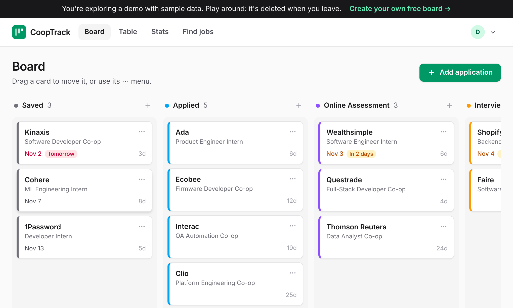
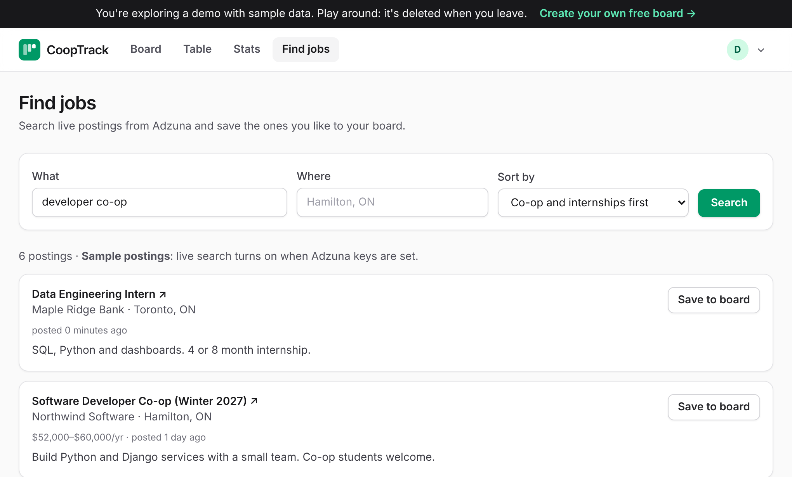
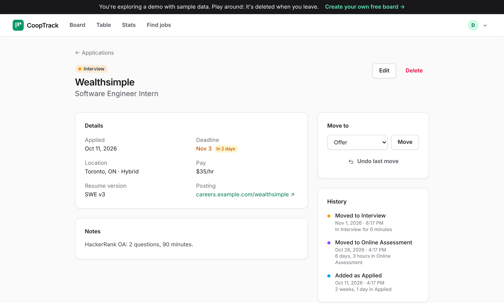

# CoopTrack

Find co-op and internship postings and track every application on one board.

My SFWRTECH 4SA3 term project.



## Features

- **Find jobs**: search live postings from the [Adzuna](https://developer.adzuna.com) API, sort them, and save
  one to your board.
- **Board**: drag applications from Saved to Offer. They only move forward (skipping is fine), anything open
  can go to Rejected, and Offer and Rejected are final.
- **Undo**: every move can be undone, from the toast or the application page.
- **Command line**: `python manage.py cooptrack` does the same things as the website, on the same data.
- **History**: every stage change is saved with the time and whether it came from the website, the CLI or
  a CSV import.
- Table with search and filters, stats, CSV import/export, a demo with sample data, dark mode.

| Find jobs | Application page |
|---|---|
|  |  |

## Run it

Needs Python 3.12+.

```bash
python3 -m venv .venv
source .venv/bin/activate
pip install -r requirements.txt
cp .env.example .env        # fill in the database URL and Adzuna keys
python manage.py migrate
bin/tailwind -i assets/app.css -o static/dist/app.css
python manage.py runserver
```

Open http://localhost:8000 and sign up, or click **Try the demo**.

Command line:

```bash
python manage.py cooptrack --user you@example.com list
python manage.py cooptrack --user you@example.com move 12 interview
python manage.py cooptrack --user you@example.com undo 12
python manage.py cooptrack --user you@example.com history 12
python manage.py cooptrack --user you@example.com search "developer co-op" --where Ontario --rank student
python manage.py cooptrack --user you@example.com save adzuna-5012345678
```

Tests: `pytest` (and `pytest -m e2e` for the browser tests).

## Architecture

```
tracker/
  domain/        stage rules (State), search ranking (Strategy), undo (Memento)
  services.py    ApplicationService, used by both the website and the CLI
  views.py       website
  management/commands/cooptrack.py   CLI
  adzuna.py      Adzuna API client
  models.py      database tables
accounts/        sign-in, demo, settings, account deletion
templates/, static/
```

- **Cloud database**: PostgreSQL on Supabase, through the Django ORM.
- **Third-party service**: Adzuna job search REST API.
- **Two interfaces, one implementation**: the website and the CLI both call `ApplicationService`, so the
  rules aren't duplicated.

### Design patterns

- **State** (`tracker/domain/stages.py`): each stage is an object that decides where an application can move
  next and what happens when it's saved.
- **Strategy** (`tracker/domain/ranking.py`): four interchangeable ways to rank search results.
- **Memento** (`tracker/domain/undo.py`): a snapshot is saved before each move so it can be undone. Not covered
  in class; see [Refactoring Guru](https://refactoring.guru/design-patterns/memento).

### Non-functional requirements

- **Traceability**: every stage change writes a history row (stages, time, interface, undo or not) in the same
  transaction as the change.
- **Maintainability**: rules live in the domain package, changes go through one service, and the interfaces
  only handle input and output. Access to a user's data is checked in one place (`tracker/scoping.py`).
